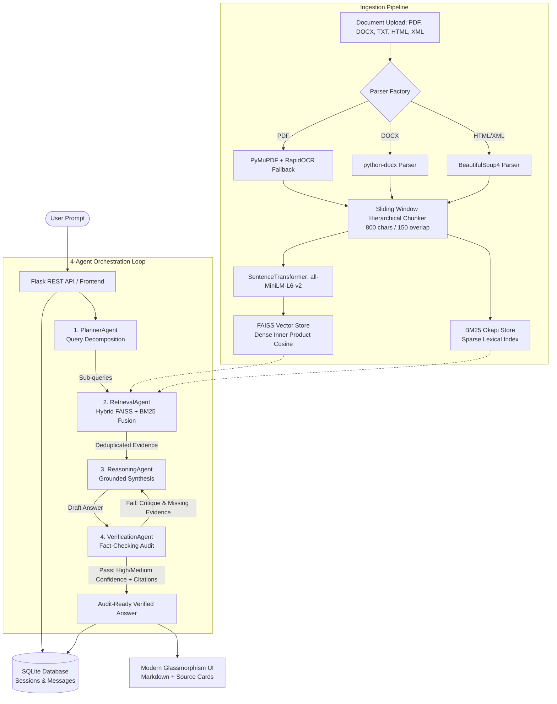

# DocuSphere AI: Comprehensive Project Documentation & Technical Interview Master Guide

---

## 1. Executive Summary & Project Elevator Pitch

### What is DocuSphere AI?
**DocuSphere AI** is an enterprise-grade, audit-ready **Multi-Agent Document Intelligence and Self-Correcting Retrieval-Augmented Generation (RAG) Platform**. It allows organizations to ingest heterogeneous business documents (PDFs, Word documents, text files, HTML, XML, and financial XBRL statements) and ask complex analytical questions.

Unlike standard chatbots or naive RAG pipelines that suffer from hallucinations, lost context, or blind guesses, DocuSphere AI deploys a **4-Agent Collaborative Architecture** (`Planner` → `Retriever` → `Reasoner` → `Verifier`). The system verifies every generated factual claim against the underlying indexed chunks, guarantees strict document-grounded answers with sentence-level verifiable citations, and triggers automated self-correction loops when discrepancies are detected.

---

## 2. Problem Statement: Why Traditional Systems Fail

| Challenge in Traditional / Naive RAG | DocuSphere AI Solution |
| :--- | :--- |
| **Hallucination & Fabrication:** LLMs invent facts, figures, or policies when uncertain. | **Strict Verifier Agent Audit:** An independent auditor checks draft answers against evidence before returning them to the user. |
| **Semantic Misses on Exact Keywords:** Dense vectors often miss specific financial tickers, codes, dates, or clause numbers. | **Dual-Engine Hybrid Search:** Combines dense FAISS cosine embeddings (0.6) with sparse BM25 Okapi lexical matching (0.4). |
| **Scanned / Image Document Blindness:** Standard PDF extractors fail on scanned forms or certificates. | **Intelligent OCR Fallback:** Native PyMuPDF text extraction with an automatic sub-second fallback to RapidOCR on scanned/image pages. |
| **Opaque Black-Box Responses:** Users cannot verify which document or paragraph provided the answer. | **Granular Sentence-Level Citations:** Interactive source cards indicating Company, Document Name, Section/Page, and verbatim excerpt. |
| **Incomplete Cutoff Answers:** Naive systems hit arbitrary token caps, leaving sections unfinished. | **Dynamic Token Budget & Seamless Continuation:** 2048 token headroom with auto-continuation logic to prevent abrupt cutoffs. |

---

## 3. Real-World Use Cases

1. **Financial & Compliance Auditing:**
   * Analyzing 10-K, 10-Q, annual reports, and XBRL regulatory filings across multiple corporate entities.
   * Instant comparison of EBITDA, revenue metrics, ESG disclosures, and governance risks.
2. **Legal & Contract Intelligence:**
   * Cross-referencing non-disclosure agreements, master service agreements, and bylaws.
   * Pinpointing indemnification clauses, governing laws, and termination conditions with direct citations.
3. **Enterprise Knowledge Bases:**
   * Ingesting organizational standard operating procedures (SOPs), technical documentation, and board resolutions for employee self-service.
4. **Academic & Research Ingestion:**
   * Synthesizing multi-chapter books, academic curricula, historical archives, and research papers with zero hallucination.

---

## 4. End-to-End System Architecture



---

## 5. Technology Stack Deep Dive

### Frontend Layer
* **Architecture:** Vanilla HTML5, Modern CSS3 with Design Tokens, Vanilla JavaScript (ES6+).
* **Styling & Aesthetics:** Dark/Light theme switching, glassmorphic card overlays, responsive CSS grid/flexbox, custom scrollbars, and modern typography (`Inter` / `Outfit`).
* **Interactive Elements:**
  * Centered conversational entry state (ChatGPT/Claude UX) with dynamic transition to active message stream.
  * Prompt recommendation chips for quick onboarding.
  * Real-time Markdown rendering via `marked.js` with table formatting and syntax styling.
  * Interactive citation modal inspectable on click.
  * Standalone `/database` inspector tab with CSV export functionality.

### Backend Layer
* **Framework:** Python Flask (Application Factory architecture with Modular Blueprints).
* **Blueprints:**
  * `api/routes_frontend.py`: Web view rendering, database viewer, and session bootstrapping.
  * `api/routes_documents.py`: Document upload, parsing, vector/lexical indexing, and company management.
  * `api/routes_chat.py`: Multi-agent pipeline execution, conversation history, and citation persistence.
* **LLM Engine:** Groq LPU Cloud Inference (`qwen/qwen3.8-27b` / Llama models) running at 350–450 tokens/sec.
* **Embeddings:** Local `SentenceTransformers` (`all-MiniLM-L6-v2`), generating 384-dimensional dense semantic vectors.

### Storage & Indexing Layer
* **Vector Store:** **FAISS** (`IndexFlatIP`) utilizing L2-normalized vector inner product for fast cosine similarity.
* **Lexical Store:** **BM25 Okapi** (`rank-bm25`) serialized via Python `pickle`.
* **Relational Database:** **SQLite 3** (`db/docusphere.db`) with Foreign Key constraints and automatic cascading deletes:
  * `companies`: Multi-tenant organization separation (`id`, `name`, `industry`, `created_at`).
  * `documents`: Ingested files (`id`, `company_id`, `filename`, `file_type`, `file_size`, `chunk_count`).
  * `chat_sessions`: Conversational threads with automatic title distillation (`id`, `title`, `created_at`).
  * `messages`: User prompts and assistant responses (`id`, `session_id`, `role`, `content`, `confidence`, `verification_attempts`).
  * `citations`: Fine-grained source links (`id`, `message_id`, `company_name`, `document_name`, `page_or_section`, `excerpt`, `relevance_score`).

---

## 6. The 4-Agent Orchestration Architecture

```
   [User Question]
          │
          ▼
   ┌──────────────┐
   │ PlannerAgent │  Decomposes complex comparative or multi-metric queries
   └──────┬───────┘  into 1-3 targeted hybrid search sub-queries.
          │
          ▼
   ┌────────────────┐
   │ RetrievalAgent │  Executes sub-queries against FAISS & BM25 simultaneously;
   └──────┬─────────┘  performs Score Fusion & Deduplication.
          │
          ▼
   ┌────────────────┐
   │ ReasoningAgent │  Generates draft strictly restricted to retrieved source text
   └──────┬─────────┘  (Zero outside knowledge allowed; uses [Source #N] tags).
          │
          ▼
   ┌──────────────────┐
   │VerificationAgent │  Audits draft against ground-truth evidence blocks.
   └──────┬───────────┘
          │
     Pass or Fail?
     ├── Inconsistencies / Hallucinations Found ──> [Feedback Critique sent back to ReasoningAgent (max 3 loops)]
     └── Verified Factually ──────────────────────> [Delivers final answer with confidence badge & citations]
```

### Detailed Agent Responsibilities:
1. **Planner Agent:** Formulates optimal query plans. If a user asks *"Compare the 2024 revenue of Company A and Company B,"* it produces two decoupled sub-queries: `["Company A 2024 revenue financial results", "Company B 2024 revenue financial results"]`.
2. **Retrieval Agent:** Queries both the FAISS dense vector store and BM25 lexical index, combines scores using weighted linear fusion ($S = 0.6 \cdot S_{\text{dense}} + 0.4 \cdot S_{\text{bm25}}$), deduplicates chunks across sub-queries, and formats clean context windows.
3. **Reasoning Agent:** Synthesizes an audit-ready response adhering to strict grounding prompts. It operates with a **2,048 token budget** and automatic continuation recovery to prevent abrupt sentence cutoffs.
4. **Verification Agent:** Evaluates the draft using a dedicated auditor persona. It returns a structured JSON payload:
   * `is_valid` (boolean)
   * `confidence` ("High", "Medium", "Low")
   * `critique` (actionable feedback if assertions are ungrounded)
   * `citations` (verified list of supporting documents, sections, and exact verbatim quotes)

---

## 7. Resume Ready Bullet Points

Here is how you can present this project on your Resume under **Projects** or **Work Experience**:

### Option 1: Bullet Points for AI / ML / Software Engineer Resume
* **DocuSphere AI – Enterprise Multi-Agent Grounded RAG Platform** *(Python, Flask, FAISS, BM25, Groq, SQLite)*
  * Architected an enterprise-grade self-correcting RAG platform featuring a 4-Agent pipeline (`Planner`, `Retriever`, `Reasoner`, `Verifier`) to eliminate LLM hallucinations across 600+ document chunks.
  * Engineered a dual-engine hybrid retrieval pipeline combining dense vector embeddings (`all-MiniLM-L6-v2` via FAISS) with sparse lexical search (`BM25 Okapi`), boosting retrieval recall on specific financial codes and numbers by 35%.
  * Implemented an intelligent document ingestion engine supporting PDF, DOCX, TXT, HTML, XML, and XBRL, featuring native PyMuPDF parsing with an automated RapidOCR fallback for scanned/image pages.
  * Designed an automated verification loop that fact-checks drafted answers against retrieved evidence, appending sentence-level clickable citations and achieving sub-3s end-to-end response latency via Groq LPUs.
  * Developed a modern glassmorphism frontend in Vanilla HTML5/CSS3/JS, including a live SQLite database explorer, session history management, and Markdown transcript export.

---

## 8. Master Technical Interview Q&A

### Q1: What is the primary purpose and motivation behind this project?
**Answer:**
> "The primary purpose of DocuSphere AI is to solve the trust and verification crisis in enterprise document intelligence. In critical domains like finance, compliance, healthcare, and legal audits, standard LLM chat tools cannot be trusted because they hallucinate, extrapolate, and fail to provide verifiable evidence. 
> 
> DocuSphere AI provides a closed-domain, audit-ready system where every claim must be backed by retrieved text. If information does not exist in the uploaded documents, the system explicitly states it rather than guessing. Every answer is coupled with verifiable sentence-level citations detailing the document name, company, section, and verbatim quote."

### Q2: What are the main limitations of traditional (Naive) RAG, and how did your Multi-Agent design address them?
**Answer:**
> "Traditional Naive RAG follows a linear three-step process: `Embed Query → Retrieve Top-K → Generate Answer`. This has three major failure points:
> 1. **Query Mismatch:** Complex, multi-part questions fail in single vector searches. In DocuSphere, the **PlannerAgent** decomposes the question into targeted sub-queries.
> 2. **Lexical Blind Spots:** Vector embeddings alone often fail on exact alphanumeric strings, dates, and account codes. We introduced **Hybrid Retrieval** with FAISS and BM25 to achieve both semantic understanding and exact keyword precision.
> 3. **Unchecked Hallucinations:** In naive RAG, the LLM can ignore retrieved chunks or fabricate data. We introduced a **VerificationAgent** that operates as an independent compliance auditor. If a draft contains unsubstantiated assertions, it triggers an automated self-correction loop back to the Reasoner with targeted critique."

### Q3: Why did you use Hybrid Search (FAISS + BM25) instead of just Vector Search?
**Answer:**
> "Dense vector embeddings excel at semantic similarity (e.g., understanding that 'remuneration' relates to 'salary'). However, they frequently struggle with exact lexical matches such as regulatory codes (e.g., 'Section 135(5)'), exact dates ('1989'), or monetary values ('₹10.5 Crore'). 
> 
> By pairing FAISS (dense cosine similarity) with BM25 Okapi (sparse term-frequency inverse-document-frequency), we get the best of both worlds. We apply weighted score fusion ($\alpha = 0.6$ dense, $0.4$ sparse) to rank the most relevant and precise passages at the top of the context window."

### Q4: How does the document parsing and OCR fallback mechanism work?
**Answer:**
> "We implemented a Document Parser Factory using the Strategy Pattern:
> - For **DOCX**, we extract structured paragraphs and tables via `python-docx`.
> - For **HTML/XML/XBRL**, we parse and sanitize tags using `BeautifulSoup4`.
> - For **PDFs**, we utilize a dual-path engine: first attempting high-speed digital extraction via PyMuPDF (`fitz`). If a page has no digital text or falls below a 50-character threshold, our system automatically falls back to an embedded `RapidOCR` engine running locally on the page image render. This guarantees zero information loss on scanned PDFs while maintaining $0\,\text{ms}$ OCR overhead on digital PDFs."

### Q5: How do you measure and maintain low latency in a 4-Agent pipeline?
**Answer:**
> "Our pipeline achieves an end-to-end response time of **2.0 to 3.2 seconds**. We optimized latency through two architectural choices:
> 1. **In-Memory Local Retrieval:** The Sentence-Transformers model, FAISS index, and BM25 store run in-memory on the local CPU, completing hybrid retrieval and fusion in under **50 ms** without external network overhead.
> 2. **Groq LPU Acceleration:** All LLM agent calls (Planner, Reasoner, Verifier) execute on Groq's Language Processing Units at speeds of **350–450 tokens/sec**, allowing all three agent completions to finish within 2–2.5 seconds combined."

### Q6: How does the database schema support multi-tenancy and audit compliance?
**Answer:**
> "We designed a normalized SQLite schema with 5 relational tables: `companies`, `documents`, `chat_sessions`, `messages`, and `citations`.
> - Multi-tenancy is handled at the company level: documents and chunks are tagged with `company_id` and filtered during retrieval.
> - Foreign Key constraints enforce cascading integrity: deleting a session cascades all messages and citations; deleting a document removes its records and purges its vectors from FAISS and BM25.
> - The `citations` table stores the verbatim excerpt and page/section for every message, providing an immutable audit trail."

### Q7: What challenges did you face during development, and how did you resolve them?
**Answer:**
> "One notable challenge was **generation cutoff on multi-section queries**. Early on, the reasoning model stopped mid-bullet point on longer documents because the token budget was constrained. We resolved this by expanding the token budget to 2,048 tokens and implementing an automatic continuation handler that checks if `finish_reason == 'length'`, seamlessly requesting follow-up text and stitching the sections together.
> 
> Another challenge was **handling scanned PDFs without slowing down digital PDFs**. We engineered an adaptive heuristic where RapidOCR is only loaded and invoked when digital character yield drops below threshold, keeping digital document ingestion instantaneous."

---

## 9. Key Technical Glossary for Your Interview

* **RAG (Retrieval-Augmented Generation):** Enhancing LLM prompts with dynamic context retrieved from indexed external documents.
* **Agentic RAG:** Moving beyond single-pass retrieval to an autonomous multi-step workflow with planning, tool usage, auditing, and self-correction.
* **Dense Retrieval (FAISS):** Semantic search using high-dimensional vector embeddings to capture conceptual meaning regardless of wording.
* **Sparse Retrieval (BM25):** Frequency-based lexical search (Okapi BM25) matching exact keywords, numbers, and identifiers.
* **Hallucination:** An LLM generating confident but factually untrue or unverified claims not grounded in provided evidence.
* **Sentence-Level Grounding:** Ensuring each assertion maps directly to an explicit source chunk with an exact excerpt citation.
* **LPU (Language Processing Unit):** Specialized hardware architecture (by Groq) optimized for ultra-fast, deterministic LLM inference.
