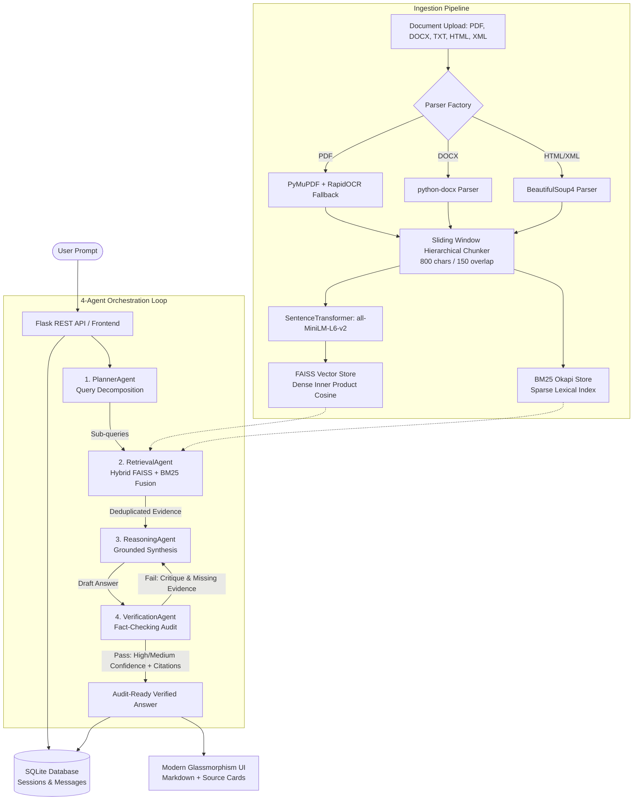

# DocSphere AI — Enterprise Multi-Document Intelligence & Grounded Multi-Agent RAG Platform

> **An audit-ready, enterprise-grade Document Intelligence platform featuring a 4-Agent Self-Correcting loop (`Planner` → `Retriever` → `Reasoner` → `Verifier`), Dual-Engine Hybrid Search (FAISS + BM25), and Multi-Format Ingestion with adaptive OCR.**

---

## 🌟 Key Features

- **Autonomous 4-Agent Orchestration:**
  - `PlannerAgent`: Decomposes complex queries into focused sub-queries.
  - `RetrievalAgent`: Executes concurrent hybrid vector & lexical search with score fusion.
  - `ReasoningAgent`: Synthesizes answers strictly bounded to retrieved context.
  - `VerificationAgent`: Acts as an independent zero-trust auditor, fact-checking every assertion against source chunks and triggering automated self-correction loops.
- **Dual-Engine Hybrid Retrieval:** Combines dense semantic cosine vectors (**FAISS `IndexFlatIP`**) with sparse lexical search (**BM25 Okapi**) via weighted rank fusion ($0.6 \times \text{Dense} + 0.4 \times \text{Sparse}$).
- **Heterogeneous Multi-Format Ingestion:**
  - Standard & Scanned **PDFs** (with adaptive zero-copy **RapidOCR** fallback).
  - Word Documents (**DOCX** / **DOC**).
  - Plain Text / Markdown (**TXT** / **MD**).
  - Web Pages (**HTML** / **HTM**).
  - Regulatory / Financial Filings (**XML** / **XBRL**).
- **Sub-Second Vector Deletion:** Instant in-memory vector reconstruction (`reconstruct_n`), achieving < 5ms deletion with zero index corruption.
- **Verifiable Audit Trail:** Interactive sentence-level citations with exact page/section and verbatim quotes.
- **Multi-Tenancy:** Organizational metadata tagging (`company_id`) for strict data boundary isolation.
- **Full-Stack Glassmorphism UI:** Modern responsive web interface with dark/light themes, live markdown rendering, session history search, and a relational database inspector (`/database`).

---

## 🏗️ Architecture



---

## 🛠️ Technology Stack

- **Backend:** Python, Flask (Application Factory & Blueprints)
- **LLM Engine:** Groq Cloud LPU (`qwen/qwen3.8-27b` / `llama-3.3-70b-versatile`)
- **Embeddings:** `SentenceTransformers` (`all-MiniLM-L6-v2`, 384-dimensional)
- **Vector Search:** `FAISS` (`IndexFlatIP` with L2 normalization)
- **Lexical Search:** `BM25 Okapi` (`rank-bm25`)
- **OCR Engine:** `RapidOCR` (ONNX Runtime)
- **Document Parsing:** `PyMuPDF` (`fitz`), `python-docx`, `BeautifulSoup4`, `lxml`
- **Database:** `SQLite 3` with relational foreign keys and cascading deletes
- **Frontend:** Vanilla HTML5, Modern CSS3 with Design Tokens, Vanilla JavaScript (ES6+), `marked.js`

---

## 🚀 Quickstart Guide

### 1. Clone the Repository
```bash
git clone https://github.com/YOUR_USERNAME/DocSphere-AI.git
cd DocSphere-AI
```

### 2. Create and Activate Virtual Environment
```bash
# Windows
python -m venv venv
.\venv\Scripts\activate

# Linux / macOS
python3 -m venv venv
source venv/bin/activate
```

### 3. Install Dependencies
```bash
pip install -r requirements.txt
```

### 4. Configure Environment Variables
Copy `.env.example` to `.env`:
```bash
cp .env.example .env
```
Open `.env` and insert your **Groq API Key**:
```env
GROQ_API_KEY=your_actual_groq_api_key_here
```

### 5. Launch the Platform
```bash
python app.py
```
Open your browser and navigate to:
```
http://127.0.0.1:5000
```

---

## 🧪 Running Automated Tests

Run the complete 12-test automated suite:
```bash
python -m unittest discover tests
```

---

## 📄 License
MIT License.
